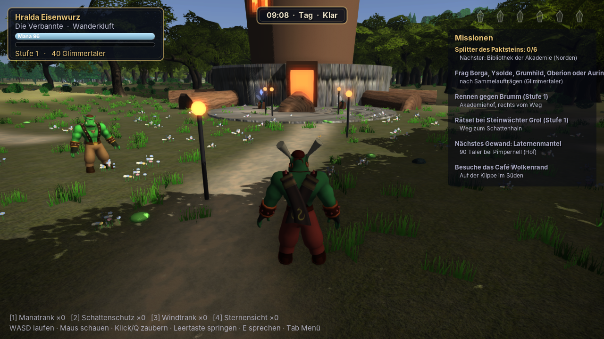
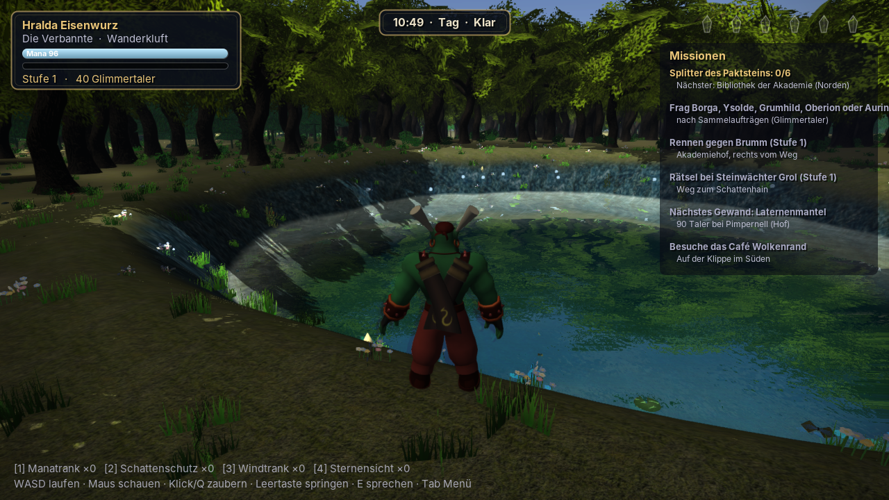
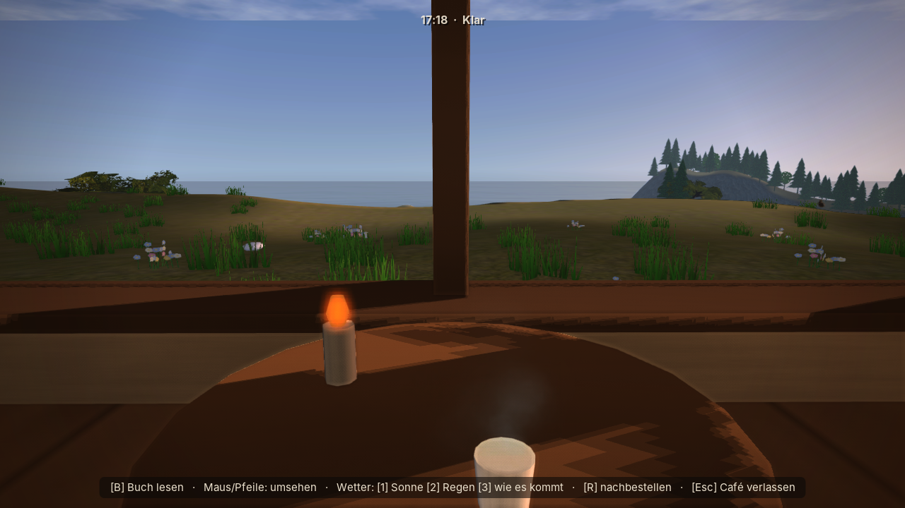
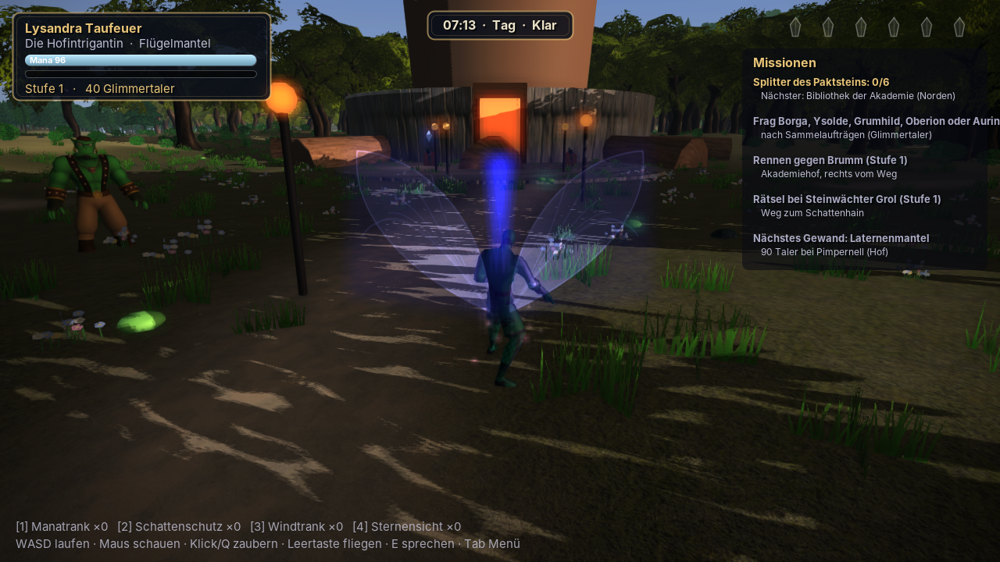
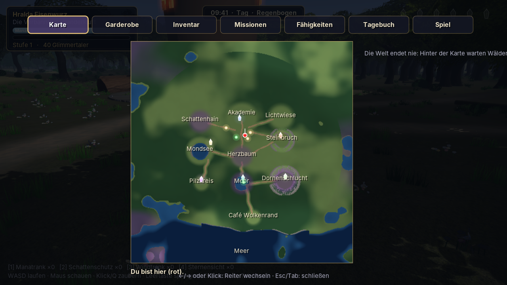
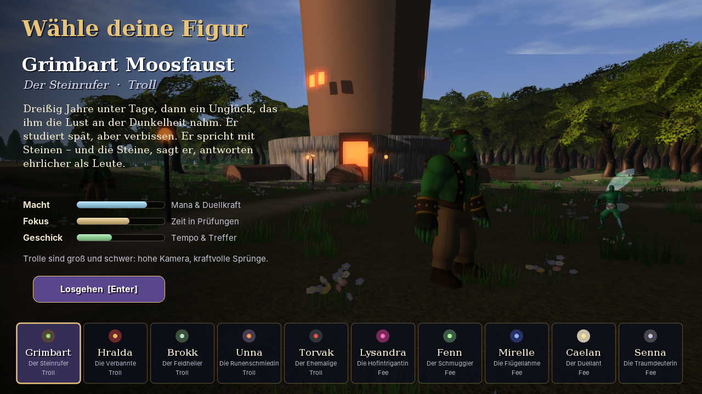
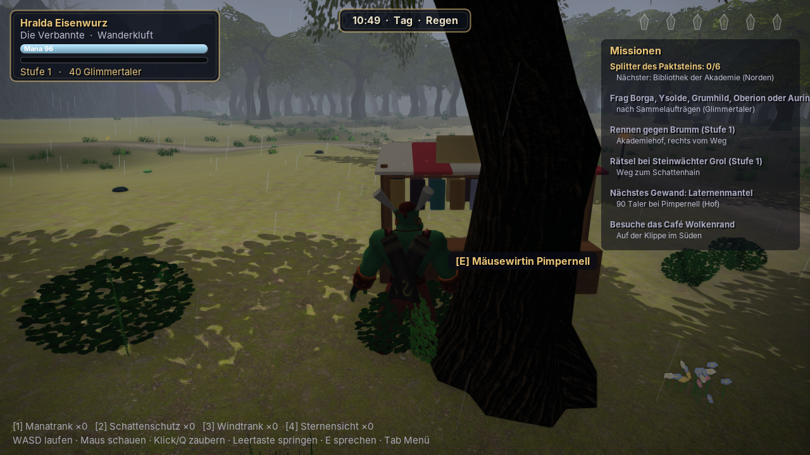

# Das Flüstern im Dämmerwald

Ein 3D-Fantasy-Abenteuer für Erwachsene in Java (jMonkeyEngine 3.6). Gespielt wird in der **Third-Person-Perspektive**: Du siehst deine Figur von hinten, während sie durch eine fast **endlose Welt** läuft. Die Welt hat einen **Tag-Nacht-Zyklus mit Sonnenauf- und -untergang** (ein Tag dauert 15 Minuten), **Wetter** mit Regen und Regenbogen und **selbst komponierte Orchestermusik**.

Trolle und Feen, eine Zauberakademie in den Wurzeln eines uralten Baumes, ein sterbender Wald und ein Pakt, der mehr kostet, als alle zugeben. Gemordet wird nicht: Konflikte werden mit Zaubern, Willenskraft und Entscheidungen ausgetragen.



| | |
|---|---|
|  |  |
|  |  |
|  |  |

## Starten

Du brauchst **Java 17 oder neuer** und eine Grafikkarte mit OpenGL 3.2 (praktisch jeder Rechner der letzten zehn Jahre).

```sh
./start.sh        # Linux / macOS
start.bat         # Windows
```

Beim ersten Start lädt Gradle die 3D-Engine herunter, das dauert einen Moment. Für schwächere Rechner gibt es einen Sparmodus:

```sh
./gradlew run -Ddw.low=true
```

Der Spielstand liegt in `~/.daemmerwald/spielstand.properties`.

## Steuerung

| Taste | Aktion |
|---|---|
| WASD | laufen |
| Maus | Kamera drehen (Mausrad: Zoom) |
| Linksklick / Q | Lichtzauber: verbrennt die Welke, vertreibt Schattenwesen |
| Leertaste | springen (Troll) · flattern (Fee) · fliegen (mit Flügelmantel) |
| Umschalt | rennen (ab Stufe 2) |
| E | sprechen, benutzen, einkaufen, brauen |
| 1–4 | Tränke trinken |
| Tab / Esc / M | Menü: Karte, Garderobe, Inventar, Missionen, Fähigkeiten, Tagebuch, Speichern |

Rechts am Bildschirmrand stehen immer deine **aktuellen Missionen**.

## Was es gibt

* **10 Figuren** (5 Trolle, 5 Feen) mit eigener Geschichte und eigenen Werten. Trolle sind groß und springen kraftvoll, Feen sind klein und können flattern.
* **Hauptgeschichte:** Sammle die sechs Splitter des Paktsteins und entscheide am Herzbaum über das Schicksal des Waldes. Es gibt zwei Enden, danach geht das Spiel **endlos** weiter.
* **Eine endlose Welt:** Im Zentrum liegen die Story-Orte (Akademie, Herzbaum, Mondsee, Steinbruch, Moor, Pilzkreis, Dornenschlucht, Schattenhain, Lichtwiese), im Süden das Meer mit dem Café auf der Klippe. In alle anderen Richtungen setzen sich Wälder, Wiesen, Seen, Berge und geheimnisvolle Steinkreise ohne Ende fort.
* **Fröhliche und dunkle Orte:** Auf Lichtungen leben Lichtfüchse, die dir Mana schenken. An Orten der Welke und nachts streifen Schattenwölfe und Welkenmotten umher.
* **Viele Minispiele, alle endlos wiederholbar und von Mal zu Mal schwerer:**
  Runen nachzeichnen · Irrlichter fangen · Steinturm stapeln · Tränke brauen (Gedächtnis) · Erinnerungs-Memory · Dornenflug · Zauberduelle mit schnellen Tastenkombinationen · Rätsel beim Steinwächter · **Wettrennen gegen Brumm den Troll** quer durch die 3D-Welt · Zufallsprüfungen bei der Lichtfee Aurin
* **Sammeln und Brauen:** Sechs Zutaten wachsen je nach Gegend überall in der Welt. Aus ihnen braust du an Kesseln vier Tränke. Figuren vergeben **Sammelaufträge** gegen Glimmertaler.
* **Pimpernells Fadenwerk:** Der Kleiderladen einer großen, magischen Maus verkauft **18 Gewänder mit Gadgets**, zum Beispiel einen Flügelmantel zum Fliegen, eine Rüstung zur Verteidigung, einen Taucheranzug, Windläufer-Stiefel, einen Schattentarnmantel, Sprungfeder-Gamaschen, eine Glücksweste oder das Sternengewand.
* **Stufen und Fähigkeiten:** Erfahrung bringt Stufen, Stufen bringen neue Fähigkeiten wie Windschritt, Lichtlanze, Seelenschild oder einen Irrlichtbegleiter.
* **Viele Details:** Nadel- und Laubbäume mit Herbstfärbung, Farne, Büsche, bemooste Baumstämme, Pilzgruppen, Schilf und Seerosen, Schmetterlinge, Libellen, fallendes Laub, Hasen auf den Wiesen, Umgebungsverdeckung (SSAO) und Lichtstrahlen bei tief stehender Sonne.
* **Café Wolkenrand:** Ein Ort nur zum Entspannen. Die Fee Lumi fragt, was du trinken möchtest, du setzt dich ans Fenster, und das Spiel speichert. Draußen wechseln Sonne, Regen und Regenbogen, Vogelschwärme ziehen vorbei, in der Ferne springen Wale, und manchmal gleitet ein leuchtender Himmelsrochen vorüber. Im Bücherregal stehen **vier vollständige Geschichten** zum Lesen.

## Technik

* Alles ist in Java geschrieben. Gelände, Himmel, Wetter, Musik und die meisten Modelle werden **prozedural im Code** erzeugt.
* Fototexturen (Waldboden, Kies, Fels, Mauerwerk), das Baummodell, das Troll-Modell „Sinbad“ und das Modell, aus dem die Feen gebaut sind, stammen aus `jme3-testdata`, den freien Beispieldaten der jMonkeyEngine. Das Sinbad-Modell stammt von Zi Ye und steht unter CC BY-SA 3.0.
* Die Musik ist **kein echtes Orchester**. Ein kleiner Synthesizer im Spiel (`MusicSynth`) berechnet sie beim Start aus Streicherflächen, Ostinati, Blechbläser-„Braams“, Trommeln, Harfe und Hall. Mit `MusicExport` lassen sich die Stücke als WAV-Dateien speichern.

### Code-Überblick (`src/main/java/daemmerwald`)

| Datei | Aufgabe |
|---|---|
| `Main` | Start, Eingabe, Kamera für Menüs |
| `World3D` | Bauwerke, Lichter, Wasser, Schatten, Nebel, Bloom |
| `WorldGen` / `Chunks` | Höhenfunktion der endlosen Welt / Nachladen von Gelände, Bäumen, Gras, Zutaten |
| `DayNight` / `Weather` / `Vista` | Tag und Nacht / Wolken, Regen, Regenbogen / Wale, Vögel, Himmelsrochen |
| `Figure` | animierte Figuren, Gewand-Zubehör |
| `WorldScene` | Third-Person-Steuerung, Kreaturen, Rennen, Laden, Brauen, Menü, Missionen |
| `CafeScene` / `BookReader` / `Stories` | Café, Lesemodus, Geschichten |
| `MiniGame` und Unterklassen | alle Prüfungen (als 2D-Oberfläche über der 3D-Welt) |
| `Music` / `MusicSynth` | Musik und Klänge |
| `GameState` | Fortschritt, Speichern und Laden |
