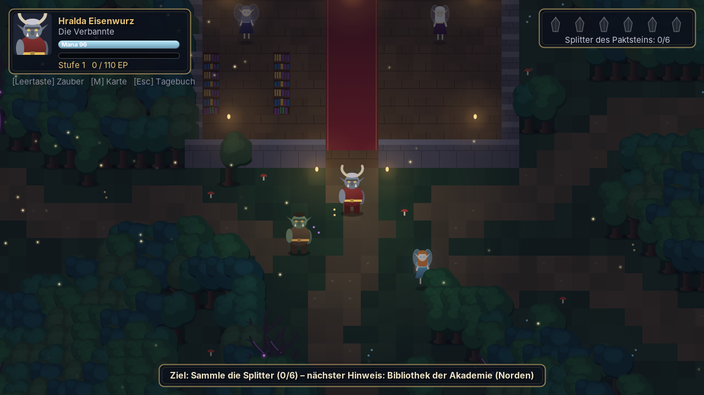
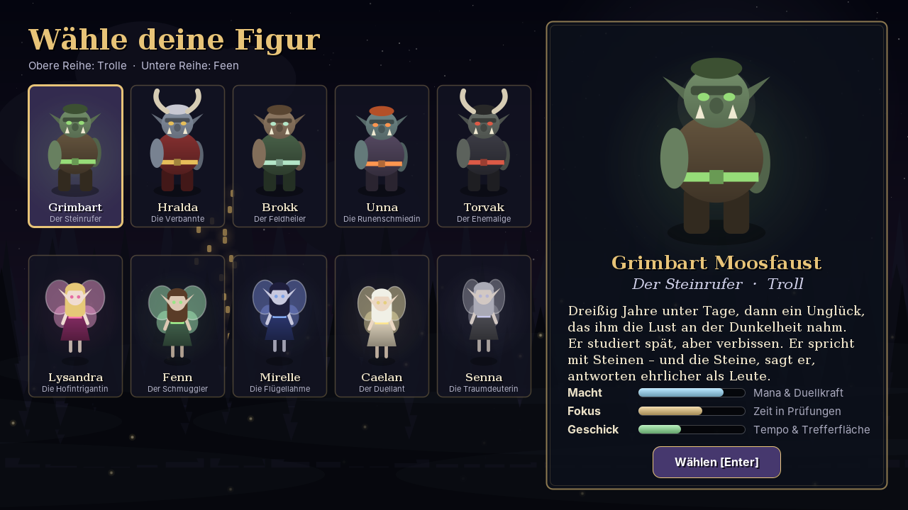
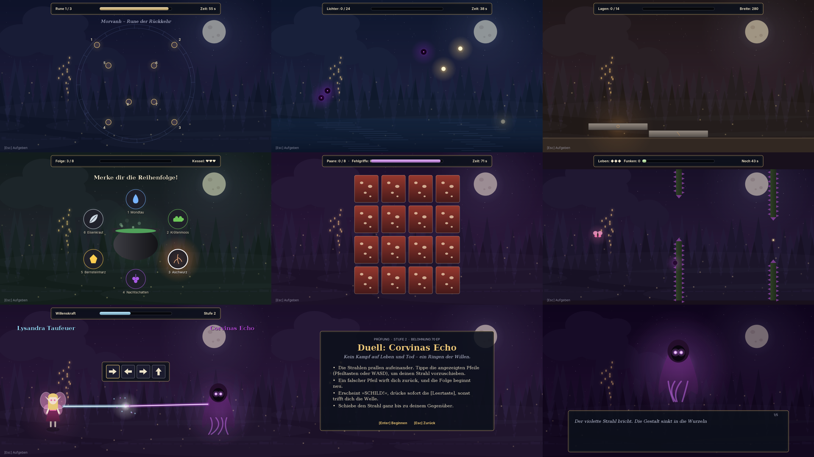

# Das Flüstern im Dämmerwald

Ein atmosphärisches Fantasy-Abenteuer für Erwachsene in reinem Java (Swing / Java2D, **keine externen Bibliotheken, keine Bilddateien** – alles wird prozedural gezeichnet).

Trolle und Feen, eine Zauberakademie in den Wurzeln eines uralten Baumes, ein sterbender Wald – und ein Pakt, der mehr kostet, als alle zugeben. Kein Gemetzel: Konflikte werden mit Zaubern, Willenskraft und Entscheidungen ausgetragen.



## Starten

Benötigt Java 17 oder neuer.

```sh
./run.sh          # Linux / macOS
run.bat           # Windows
```

oder manuell:

```sh
javac -encoding UTF-8 -d out src/daemmerwald/*.java
java -cp out daemmerwald.Main
```

## Das Spiel

* **10 spielbare Figuren** (5 Trolle, 5 Feen) mit eigener Geschichte und den Werten *Macht* (Mana, Duellkraft), *Fokus* (mehr Zeit in Prüfungen) und *Geschick* (Tempo, größere Trefferflächen).
* **Klares Ziel:** Sammle die sechs Splitter des Paktsteins und bring sie zum Herzbaum. Dort triffst du die Entscheidung, die das Ende bestimmt (zwei Enden).
* **Endlos:** Nach dem Ende geht es weiter. Jede Prüfung ist beliebig oft wiederholbar und wird jedes Mal eine **Stufe** schwerer – mit mehr Erfahrung als Belohnung.
* **Aufstieg & Fähigkeiten:** Erfahrung bringt Stufen, Stufen bringen neue Fähigkeiten:

| Stufe | Fähigkeit | Wirkung |
|---|---|---|
| 1 | Lichtzauber | Verbrennt die Welke, vertreibt Schattenwesen |
| 2 | Windschritt | [Umschalt] = schneller laufen |
| 3 | Lichtlanze | Viel größere Zauberreichweite |
| 4 | Zeitdehnung | +15 % Zeit in Prüfungen |
| 5 | Seelenschild | Schattenwesen rauben nur halb so viel Mana |
| 6 | Irrlichtbegleiter | Ein Irrlicht vertreibt Schattenwesen automatisch |
| 8 | Mondsegen | Doppelte Mana-Regeneration |
| 10 | Sternenherz | Stärkere Zauber im Duell |

### Die Welt

Helle, fröhliche Orte (Lichtwiese mit Lichtfüchsen, Mondsee, Pilzkreis, Akademiehof) und dunkle Orte voller dunkler Magie (Schattenhain, Moor, Dornenschlucht, die Welke rund um den Herzbaum). Dort streifen **Schattenwölfe** und **Welkenmotten** umher – sie rauben dir Mana, dein Lichtzauber vertreibt sie (+EP). **Lichtfüchse** schenken dir Mana.

### Die Prüfungen (Minispiele)

| Ort | Prüfung | Steuerung |
|---|---|---|
| Bibliothek – Magistra Velmara | Runen in einem Zug nachziehen | Maus |
| Mondsee – Kanzler Oberion | Goldene Irrlichter fangen, dunkle meiden | Maus |
| Steinbruch – Clanälteste Grumhild | Runensteine zum Turm stapeln | Leertaste / Klick |
| Moor – Hexe Ysolde | Zutaten-Reihenfolge merken (Trank) | Maus / Tasten 1–6 |
| Pilzkreis – Das Pilzorakel | Erinnerungs-Memory | Maus |
| Dornenschlucht – Kestra | Durch die Dornen fliegen | Pfeile / WASD |
| Herzbaum & Schattenhain (Vex) | Zauberduell: Pfeilkombos & Schild | Pfeile / WASD + Leertaste |
| Lichtwiese – Aurin | Zufällige Prüfung, 1,5× Erfahrung | – |




## Steuerung

| Taste | Aktion |
|---|---|
| WASD / Pfeiltasten | laufen |
| E / Enter | sprechen, Dialog weiter |
| Leertaste | Lichtzauber |
| Umschalt | Windschritt (ab Stufe 2) |
| M | Karte |
| Esc | Tagebuch / Pause (Splitter, Erkenntnisse, Fähigkeiten) |

## Code-Überblick (`src/daemmerwald`)

* `GamePanel` – Game-Loop, Skalierung auf 1280×720, Szenenwechsel
* `Scene` – Interface für Bildschirme (`TitleScene`, `IntroScene`, `CharacterSelectScene`, `WorldScene`, `EndingScene`)
* `WorldMap` – Kachelkarte, teils prozedural erzeugt
* `WorldScene` – Erkundung, Licht, Kreaturen, Zauber, HUD, Karte, Tagebuch
* `MiniGame` – gemeinsame Basis aller Prüfungen (Einleitung → Spiel → Ergebnis, Stufen)
* `Story` – alle Figuren und Texte · `CharacterDef` – die zehn Helden · `Ability` – Fähigkeiten
* `Art` – sämtliche Zeichenroutinen

Ein neues Minispiel: Klasse von `MiniGame` ableiten, `start/play/draw` implementieren und in `Story.createNpcs()` einer Figur zuweisen.
