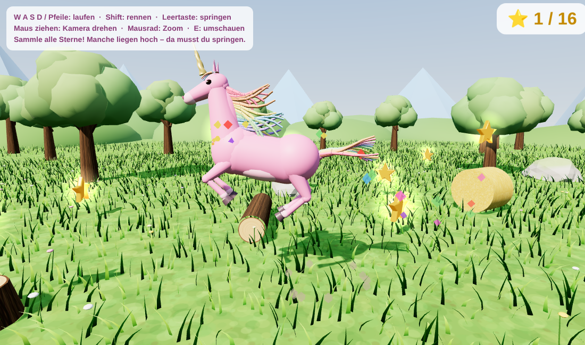

# Java beginners games
A set of interactive games to exercise core java features

## Golf game 
  

  

## Crosswords 
  

## Java Sockets Card Game SinglePlayer 
  

  

## Card Game Multiplayer 
  

  

  

## Java RMI simple application  
 

## Einhorn-Wiese 3D (HTML5 + Three.js) 
Ein pinkes Einhorn mit Regenbogen-Mähne auf einer kleinen Wiese, aus der Third-Person-Perspektive.
Keine Installation nötig: einfach `UnicornGame/index.html` im Browser öffnen (läuft auch offline, Three.js liegt in `UnicornGame/lib/`).

Ziel: alle Sterne auf der Wiese einsammeln – manche liegen auf Heuballen, Steinen oder hoch in der Luft.

Steuerung: W A S D / Pfeile laufen · Shift rennen · Leertaste springen · Maus ziehen Kamera drehen · Mausrad Zoom · E umschauen · R neue Runde.

Code-Aufbau: `js/world.js` (Himmel, Wiese, Hindernisse), `js/unicorn.js` (Einhorn-Modell & Animation), `js/stars.js` (Sterne), `js/game.js` (Steuerung, Physik, Kamera).
Auf Tablets: linke Bildschirmhälfte = Joystick, rechte Hälfte = Kamera, dazu Buttons zum Springen und Rennen.

