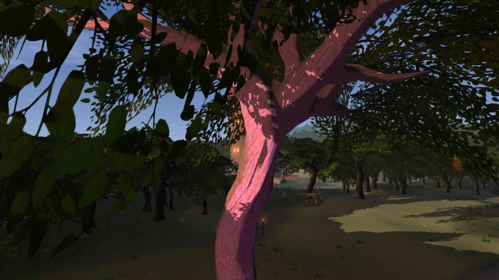

# Java beginners games
A set of interactive games to exercise core java features

## Das Flüstern im Dämmerwald (3D-Fantasy-Abenteuer) 
Trolle und Feen in einer fast endlosen 3D-Welt mit Third-Person-Kamera, Tag-Nacht-Zyklus, Wetter, selbst komponierter Musik, vielen Minispielen, einem Kleiderladen und einem Café zum Entspannen. Siehe [Daemmerwald/README.md](Daemmerwald/README.md).

## Golf game 
  

  

## Crosswords 
  

## Java Sockets Card Game SinglePlayer 
  

  

## Card Game Multiplayer 
  

  

  

## Java RMI simple application  
 
